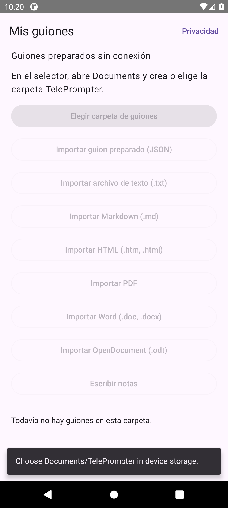
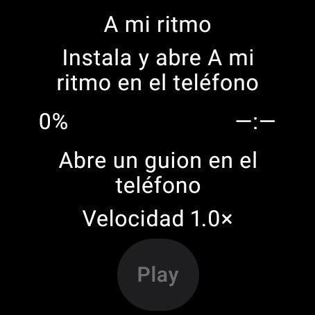

# A mi ritmo

**A mi ritmo** es un teleprompter para preparar guiones en Android y leerlos en el teléfono mientras se controlan desde la pantalla del propio teléfono o desde un reloj Wear OS compatible. Está pensado para ponencias, charlas y presentaciones en las que quien habla necesita mantener las manos libres y no perder el punto de lectura.

> **Estado del proyecto:** prototipo funcional en revisión. La versión `0.1.0` tiene APK de depuración para evaluación; todavía no es una publicación de Google Play.

## Qué incluye

- App de teléfono Android para importar o escribir guiones, revisarlos y leerlos sin conexión.
- App complementaria para Wear OS que controla la sesión activa: reproducir/pausar, ajustar la velocidad, cambiar de sección, rebobinar mientras se mantiene pulsado y volver al inicio.
- Marcador local para retomar el último punto de lectura en el teléfono.
- Ajustes de tamaño, color e interlineado; cuenta atrás de inicio y pantalla activa durante la lectura.
- Importación de texto, Markdown, HTML, PDF con texto seleccionable, Word (`.doc`, `.docx`) y OpenDocument (`.odt`).
- Guiones preparados como JSON en una carpeta del teléfono que elige la persona usuaria; exportación e importación para moverlos a otro teléfono.

## Primeros pasos

1. Descarga y descomprime el [paquete de revisión 0.1.0 r29](dist/A-mi-ritmo-review-0.1.0-r29.zip).
2. Instala `A-mi-ritmo-telefono-debug.apk`, incluido en el ZIP, en un teléfono con Android 11 (API 30) o posterior.
3. Para probar el control remoto, instala también `A-mi-ritmo-reloj-debug.apk` del mismo ZIP en un reloj Wear OS compatible y empareja los dispositivos.
4. Abre A mi ritmo en el teléfono, selecciona la carpeta `Documents/TelePrompter`, importa o crea un guion, revísalo y empieza a leer.
5. Sigue la [guía de instalación y uso](docs/usuario/guia_usuario_es.md) y registra la prueba del reloj con la [lista de QA para Wear OS](docs/release/wear_device_qa_checklist_es.md).

Las instrucciones detalladas de instalación manual, compilación y comprobación de los APK están en [compilación e instalación](docs/desarrollo/compilar_instalar_es.md). El [resumen de propósito, decisiones y estado](docs/egm/resumen_es.md), la [hoja de ruta en español](docs/egm/roadmap_es.md) y el [backlog en español](docs/egm/backlog_es.md) explican el plan activo. Los informes EGM de auditoría se conservan como historial de diseño.

## Compatibilidad declarada por el proyecto

| Componente | Mínimo de compilación | SDK objetivo actual | Versión de la app | Observaciones |
|---|---:|---:|---|---|
| Teléfono | Android 11, API 30 | API 36 | 0.1.0 (código 1) | Requiere una versión de Android que cumpla `minSdk` 30. |
| Reloj | API 30 (Wear OS 3 o posterior en el plan de QA) | API 35 | 0.1.0 (código 1000001) | El reloj controla la lectura del teléfono; no muestra el guion completo. |

Configuración de compilación: Android SDK 37, JDK 25 para el proceso Gradle y JDK 17 como toolchain/objetivo de compilación Java y Kotlin. Gradle puede descargar el JDK 25 indicado por el repositorio si no está instalado localmente; el módulo compartido necesita además su toolchain JDK 17. La compatibilidad real depende también del fabricante, los servicios de Google Play y el enlace teléfono-reloj; la lista de versiones no sustituye la prueba en el dispositivo. El Galaxy S8 con Android 9 queda por debajo del mínimo. El Galaxy A13 debe revisarse según la versión instalada en la unidad. El S23 Ultra con Android 17 indicado por la persona propietaria supera nominalmente el mínimo; falta registrar QA en el equipo físico. El reloj de referencia es Samsung Galaxy Watch7.

## Pruebas

- Hay una prueba unitaria para el códec JSON del módulo compartido: `shared/src/test/kotlin/com/teleprompter/shared/serialization/ScriptJsonCodecTest.kt`.
- Las instrucciones para ejecutar la suite y las pruebas manuales están en [compilar, instalar y probar](docs/desarrollo/compilar_instalar_es.md).
- La prueba emparejada de los comandos y la reconexión del reloj debe ejecutarse con teléfono y reloj reales. El [registro de QA de Watch7](docs/release/wear_device_qa_checklist_es.md) está preparado para anotar dispositivo, versiones, build, resultado e incidencias. Los escenarios aún no se consideran aceptados hasta rellenar ese registro.
- Las capturas de interfaz disponibles son evidencia de emulador para documentación interna, no capturas de tienda ni evidencia de aceptación física.

## Capturas

Las siguientes capturas muestran el prototipo en emuladores API 30 y Wear OS 3; la pantalla del reloj está sin una sesión conectada. No son capturas de un Watch7 físico ni recursos de tienda.

| Biblioteca inicial del teléfono | App de reloj sin sesión conectada |
|---|---|
|  |  |

El [plan de capturas para Google Play](docs/release/play_store_screenshot_plan_es.md) describe los recursos de tienda todavía necesarios. Las imágenes de icono y gráfico promocional son borradores: [paquete de revisión de Play](docs/release/play_store_review_pack_es.md).

## Documentación

- [Guía de uso](docs/usuario/guia_usuario_es.md)
- [Compilación, instalación y pruebas](docs/desarrollo/compilar_instalar_es.md)
- [QA del teléfono y Galaxy Watch7](docs/release/wear_device_qa_checklist_es.md)
- [Plan de capturas de Play](docs/release/play_store_screenshot_plan_es.md)
- [Material de revisión de Google Play](docs/release/play_store_review_pack_es.md)
- [Diseño, hoja de ruta y backlog](docs/egm/)

## Licencia y distribución

No se ha añadido todavía una licencia de código abierto. El paquete de revisión r29 incluye APK firmados con la clave de depuración del proyecto, no con una clave de publicación de Google Play. No distribuyas esos APK como versiones de producción. Los detalles y las sumas SHA-256 están en `LEEME.txt` y `SHA256SUMS.txt`, dentro del ZIP de revisión r29.
