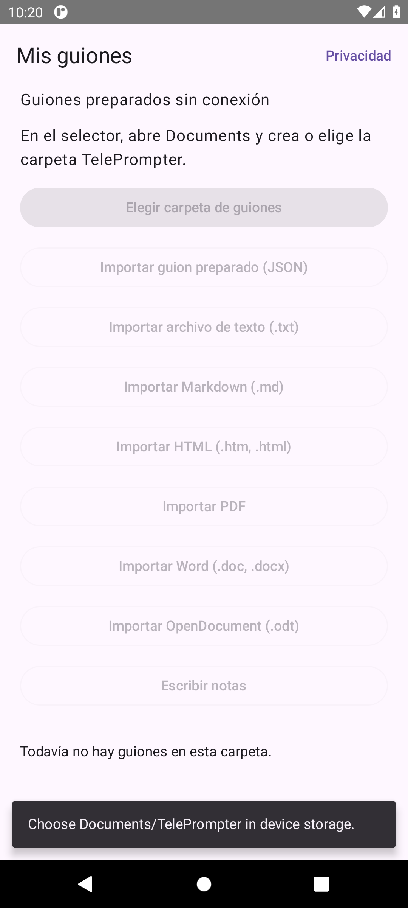
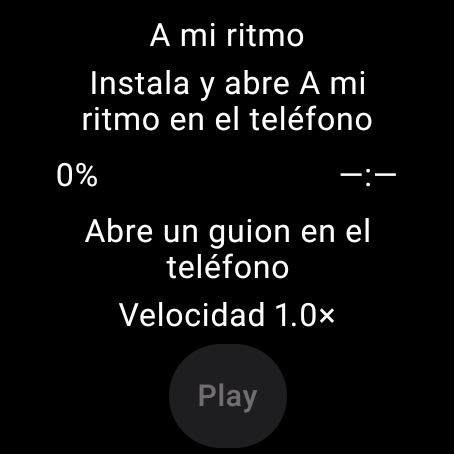

# Guía de uso de A mi ritmo

**Versión documentada:** 0.1.0 (paquete de revisión r29) · **Idioma:** español  
**Estado:** guía del prototipo; la interfaz y algunas funciones pueden cambiar antes de la publicación.

## Para qué sirve

A mi ritmo permite preparar un guion y leerlo en el teléfono colocado en un atril. La pantalla conserva un marcador visible en el texto para que sea más fácil seguir la lectura. Si hay un reloj Wear OS compatible emparejado, se puede controlar la sesión desde la muñeca sin tocar el teléfono.

La app funciona sin conexión a Internet para preparar, guardar y leer guiones. El control remoto necesita que el teléfono y el reloj puedan comunicarse mediante Wear OS Data Layer.

## Instalar

Los APK de revisión están dentro del [paquete r29](../../dist/A-mi-ritmo-review-0.1.0-r29.zip): `A-mi-ritmo-telefono-debug.apk` y `A-mi-ritmo-reloj-debug.apk`. Son APK de depuración para evaluación. Para la instalación manual se necesita Android 11/API 30 o posterior en el teléfono y un reloj Wear OS compatible (mínimo previsto: Wear OS 3/API 30). En algunos teléfonos hay que permitir temporalmente la instalación desde la fuente elegida.

Instala el APK de teléfono. Para usar el reloj, instala el APK de Wear de **la misma revisión**, empareja el reloj con el teléfono mediante Galaxy Wearable y abre A mi ritmo en ambos. No uses APK de revisiones distintas.

## Primera configuración

1. Abre A mi ritmo en el teléfono.
2. Pulsa **Elegir carpeta de guiones**.
3. En el selector de Android, abre `Documents`, crea o selecciona `TelePrompter` y confirma **Usar esta carpeta**. Autoriza el acceso cuando Android lo solicite.
4. Importa un documento o pulsa **Escribir notas** para crear un guion desde cero.

La carpeta seleccionada contiene los guiones preparados en formato JSON. El documento original que importas no se modifica.

## Importar o crear un guion

La biblioteca ofrece estas entradas:

| Tipo | Extensiones / método | Qué conviene revisar |
|---|---|---|
| Texto | `.txt` | Conserva texto y saltos de párrafo; añade los subtítulos de sección necesarios. |
| Markdown | `.md` | Conserva encabezados, énfasis, listas y tablas compatibles. Las listas anidadas se aplanan y la numeración puede reiniciarse. |
| HTML local | `.htm`, `.html` | Extrae contenido y formato reconocible, incluidos encabezados, énfasis y tablas. Comprueba el orden y el resultado. |
| PDF | `.pdf` | Funciona con texto seleccionable. Un PDF escaneado o compuesto por imágenes necesita OCR externo antes de importarlo. |
| Word | `.doc`, `.docx` | El `.doc` es extracción de texto. En `.docx` se reconocen párrafos y listas; sangrías y numeraciones complejas pueden simplificarse. |
| OpenDocument | `.odt` | Extrae texto y estructura compatible; las listas anidadas pueden aplanarse. |
| Notas | Dentro de la app | Escribe título y texto; revisa y estructura el guion antes de guardarlo. |
| Guion preparado | `.json` | Importa un guion A mi ritmo que hayas exportado previamente. |

La app no reconoce escritura a mano ni incluye OCR. Después de cualquier importación, revisa el borrador antes de guardarlo: comprueba título, subtítulos, párrafos, tablas, énfasis, listas y pausas. Si un documento contiene maquetación compleja, simplifícalo antes de importarlo.

## Revisar y guardar

La pantalla de revisión permite comprobar el contenido y preparar la estructura de lectura antes de añadirlo a la biblioteca. Usa subtítulos claros para separar el guion en secciones. Los controles de aspecto permiten ajustar tamaño de letra, colores e interlineado; revisa que el contraste se lea bien desde el atril.

Al guardar, el guion preparado se escribe como JSON en la carpeta local elegida. La posición de lectura se guarda aparte, localmente en el teléfono. Exporta el JSON desde la app para trasladar el guion a otro móvil; al abrirlo en el segundo teléfono, elige una carpeta de guiones y usa **Importar guion preparado (JSON)**. El JSON exportado no incluye el marcador de lectura de origen.

## Leer desde el teléfono

1. Abre un guion en **Mis guiones**.
2. Comprueba el tamaño de letra, el color y el interlineado.
3. Inicia la lectura con la cuenta atrás si está disponible y pulsa reproducir.
4. Usa los controles en pantalla para pausar, reanudar, ajustar la velocidad, navegar por secciones o volver al inicio.
5. Sigue el marcador fijo y visible en el texto. Al salir y volver al guion, el lector intenta restaurar la última posición guardada en ese teléfono.

La pantalla permanece activa mientras el lector está abierto para que no se atenúe durante la presentación. Esto no desactiva el modo de ahorro de energía del teléfono ni modifica No molestar.

## Controlar con el reloj

Mantén la app de teléfono abierta en el lector: el reloj es un mando remoto y el texto se lee en la pantalla del teléfono. Abre la app complementaria en el Watch7 después de emparejarlo.

| Control del reloj | Acción |
|---|---|
| Reproducir / pausa | Inicia o pausa la sesión que muestra el teléfono. |
| `+` / `−` | Aumenta o reduce la velocidad en pasos de 0,1× dentro del intervalo 0,5×–2,0×. |
| Sección anterior / siguiente | Salta a la primera línea de la sección correspondiente. |
| Mantener **Rebobinar** | Retrocede mientras se mantiene pulsado; al soltar, deja de rebobinar. |
| Al inicio | Vuelve al comienzo del guion y detiene la lectura. |

El reloj muestra el estado de la sesión, la sección, el progreso, el tiempo restante y la velocidad. No muestra el título ni el contenido del guion. Si no hay una sesión de lectura activa en el teléfono, los controles no deben controlar una lectura inexistente.

## Uso sin Internet y datos

Importar, revisar, guardar y leer guiones en el teléfono funciona sin Internet. El emparejamiento y el control del reloj dependen de la comunicación entre dispositivos y de Wear OS Data Layer; prueba la configuración concreta del teléfono y el reloj. Los guiones se guardan en la carpeta del dispositivo que seleccionaste. La posición de lectura permanece en los datos privados locales de la app del teléfono, así que no se traslada al exportar el JSON.

## Solución de problemas

- **La biblioteca está deshabilitada o vacía:** elige primero `Documents/TelePrompter` con el botón **Elegir carpeta de guiones**.
- **El reloj indica que el teléfono no está disponible:** comprueba el emparejamiento, Bluetooth, que ambas apps sean de la misma revisión y que el lector esté abierto en el teléfono.
- **No aparece el texto de un PDF:** puede ser un escaneo sin capa de texto; convierte el PDF con OCR fuera de la app o usa el documento fuente.
- **El formato importado no coincide con el original:** simplifica listas anidadas o tablas complejas y revisa el resultado antes de guardarlo.
- **El APK no se instala:** confirma que el dispositivo cumple Android 11/API 30, que el archivo se descargó completo y que ambos APK provienen del mismo paquete de revisión.

## Capturas de la interfaz

Las imágenes que acompañan esta guía son capturas de emulador para mostrar el flujo del prototipo. No son capturas de un Galaxy Watch7 ni recursos aprobados para Google Play. Consulta el [plan de capturas para tienda](../release/play_store_screenshot_plan_es.md) para los formatos requeridos antes de publicar.

### Biblioteca inicial en teléfono (emulador API 30)

### App Wear OS sin una sesión conectada (emulador Wear OS 3)

La imagen del reloj documenta el estado desconectado. No demuestra el control remoto activo ni reemplaza la prueba emparejada del [checklist Watch7](../release/wear_device_qa_checklist_es.md).
